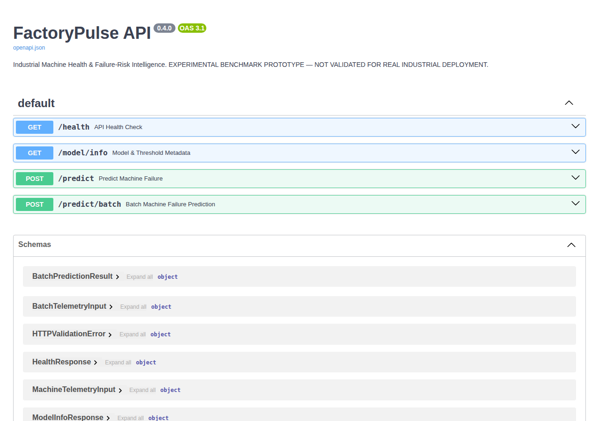
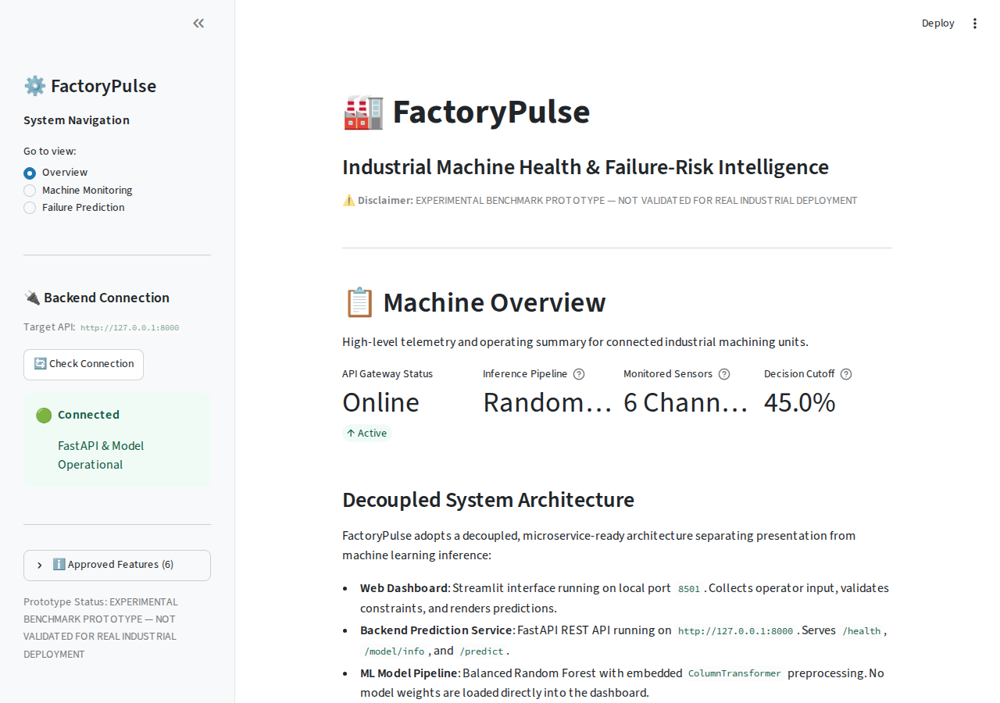
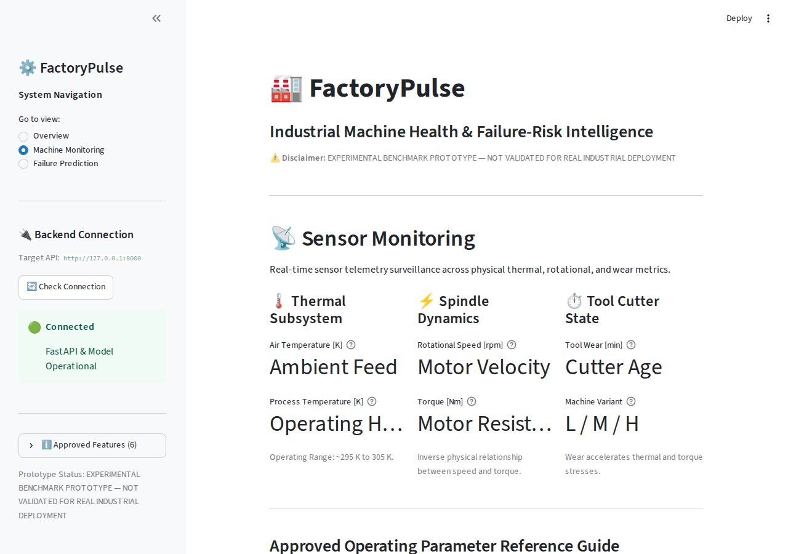
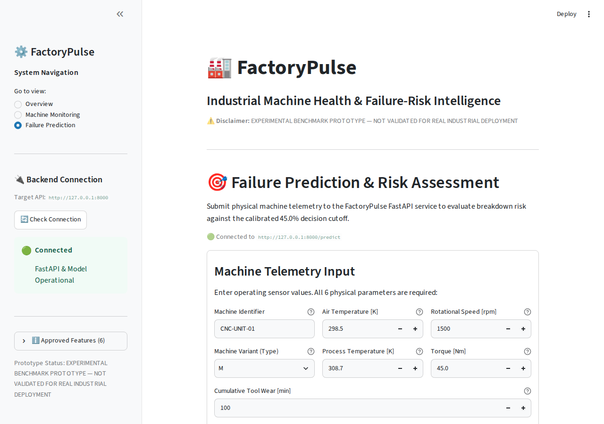

# FactoryPulse — Industrial Machine Health & Failure-Risk Intelligence

> **DISCLAIMER:** EXPERIMENTAL BENCHMARK PROTOTYPE — NOT VALIDATED FOR REAL INDUSTRIAL DEPLOYMENT.
> Predictions are generated by a benchmark model trained on synthetic data and should not be used for actual machinery safety-critical operational decisions.

FactoryPulse is an end-to-end industrial machine learning and monitoring platform designed for equipment failure risk estimation. It ingests machine telemetry, evaluates operational failure risk using a tuned Random Forest pipeline, exposes predictions via a high-performance FastAPI service, and presents real-time diagnostic intelligence through a modern Streamlit dashboard.

---

## 🏗️ Architecture & Technology Stack

- **Machine Learning**: Scikit-Learn (Random Forest Classifier, Standard Scaler, One-Hot Encoder, Stratified 5-Fold Cross-Validation, Precision-Recall Threshold Tuning).
- **Backend API**: FastAPI, Pydantic v2, Uvicorn (HTTP REST API with single and batch inference endpoints).
- **Industrial Dashboard**: Streamlit (Fleet overview, sensor telemetry monitoring, interactive single-machine failure probability evaluation).
- **Data Engineering**: Pandas, NumPy (AI4I 2020 Predictive Maintenance Dataset).
- **Automated Testing**: Pytest (100 automated unit, integration, and regression tests).

---

## 📁 Project Structure

```text
factorypulse-machine-intelligence/
├── dashboard/                      # Streamlit industrial monitoring UI
│   ├── api_client.py               # Robust HTTP client for FastAPI backend
│   └── app.py                      # Multi-page dashboard application
├── data/
│   ├── processed/                  # Feature-engineered & scaled datasets (.gitkeep)
│   └── raw/                        # Raw AI4I 2020 telemetry dataset (.gitkeep)
├── models/                         # Trained ML model pipelines (.joblib, .gitkeep)
├── reports/                        # Markdown and JSON analytical reports
│   └── figures/                    # High-resolution evaluation charts and curves
├── src/
│   ├── api/                        # FastAPI prediction backend service
│   │   ├── app.py                  # API endpoints, request validation, schemas
│   │   └── run_api.py              # Standalone API runner
│   ├── data/                       # Ingestion, schema validation, and reporting
│   │   ├── loader.py               # CSV loading and validation runner
│   │   ├── schema.py               # Schema definitions and data exceptions
│   │   └── validator.py            # Dataset validation rules and checks
│   ├── features/                   # Feature engineering & exploratory data analysis
│   │   ├── eda.py                  # Exploratory analysis and correlation diagnostics
│   │   ├── engineer.py             # Domain feature calculation (temp diff, power, strain)
│   │   └── pipeline.py             # Stratified dataset split and standard scaling
│   ├── prediction/                 # Production inference service
│   │   ├── predictor.py            # FailurePredictor service with threshold logic (0.45)
│   │   └── schemas.py              # Pydantic schemas with domain boundary validation
│   └── training/                   # Model training and optimization
│       ├── evaluate.py             # Evaluation metrics and confusion matrices
│       ├── models.py               # Pipeline construction & preprocessing
│       ├── pipeline.py             # Baseline model training and comparison
│       └── threshold_analysis.py   # 5-fold CV precision-recall threshold tuning
├── tests/                          # 100 automated pytest tests
│   ├── test_api.py                 # FastAPI route & validation tests (13 tests)
│   ├── test_dashboard_client.py    # Dashboard HTTP client tests (13 tests)
│   ├── test_data.py                # Ingestion and schema validation tests (14 tests)
│   ├── test_eda.py                 # Exploratory data analysis tests (8 tests)
│   ├── test_features.py            # Feature engineering tests (5 tests)
│   ├── test_prediction.py          # FailurePredictor service & validation (37 tests)
│   └── test_training.py            # Model training & threshold tests (10 tests)
├── .gitignore                      # Git exclusion rules (.venv, data, models, cache)
├── pytest.ini                      # Pytest configuration
├── requirements.txt                # Production dependencies
└── run.py                          # Unified command-line interface
```

---

## 🚀 Quickstart & Usage

FactoryPulse includes a unified root CLI (`run.py`) to manage all application workflows:

### 1. Environment Setup

```bash
python -m venv .venv
source .venv/bin/activate      # On Windows: .venv\Scripts\activate
pip install -r requirements.txt
```

### 2. Unified CLI (`run.py`)

| Command | Action |
|---|---|
| `python run.py api` | Start the FastAPI prediction backend (`http://127.0.0.1:8000`) |
| `python run.py dashboard` | Start the Streamlit monitoring dashboard (`http://localhost:8501`) |
| `python run.py test` | Execute the complete test suite (100 tests) |
| `python run.py validate` | Run dataset ingestion and schema verification |
| `python run.py eda` | Run exploratory data analysis and generate visual reports |
| `python run.py features` | Run feature engineering, stratified splitting, and scaling |
| `python run.py train` | Train and compare baseline classification pipelines |
| `python run.py threshold` | Run 5-fold CV decision threshold optimization |

### 3. Running Backend and Dashboard Together

Open two terminal windows:

**Terminal 1 (FastAPI Service):**
```bash
python run.py api
```
Interactive Swagger documentation available at: `http://127.0.0.1:8000/docs`

**Terminal 2 (Streamlit Dashboard):**
```bash
python run.py dashboard
```
Access the dashboard interface at: `http://localhost:8501`

---

## 🧪 Testing & Verification

The test suite contains 100 comprehensive automated tests covering schema validation, anti-leakage guards, model training, threshold tuning, inference validation, API endpoints, and dashboard network resilience:

```bash
python run.py test
```

```text
============================= test session starts =============================
collected 100 items

tests/test_api.py .............                                          [ 13%]
tests/test_dashboard_client.py .............                             [ 26%]
tests/test_data.py ..............                                        [ 40%]
tests/test_eda.py ........                                               [ 48%]
tests/test_features.py .....                                             [ 53%]
tests/test_prediction.py .....................................           [ 90%]
tests/test_training.py ..........                                        [100%]

============================ 100 passed in ~13s ==============================
```

---

## 🔒 Data Leakage Prevention & Safety Rules

- Diagnostic failure modes (`TWF`, `HDF`, `PWF`, `OSF`, `RNF`) and hardware identifiers (`UDI`, `Product ID`) are strictly excluded from predictive features.
- Model decisions use an optimized threshold of **0.45** (tuned via 5-fold cross-validation on the training set) rather than the arbitrary 0.50 cutoff, prioritizing failure recall while balancing precision.

---

## 📸 Screenshots

### FastAPI — Interactive API Documentation (Swagger UI)



### Streamlit Dashboard — Machine Overview



### Streamlit Dashboard — Machine Monitoring (Sensor Telemetry)



### Streamlit Dashboard — Failure Prediction & Risk Assessment


